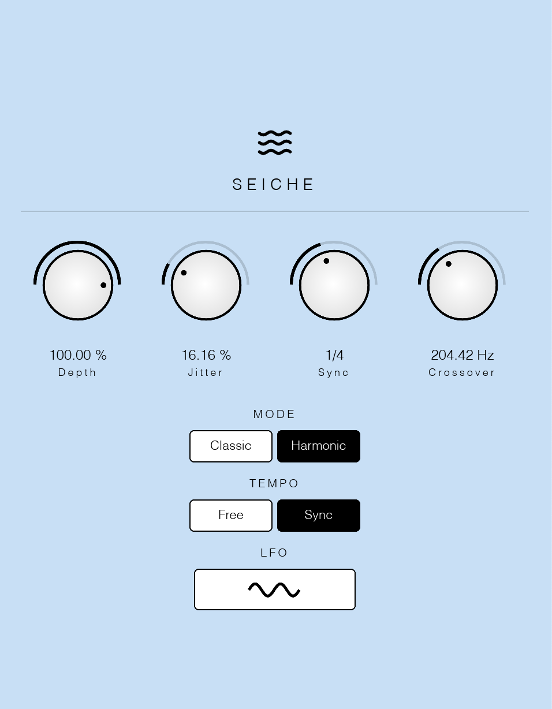

# Seiche



## Overview

Seiche is a tremolo audio plugin, available as VST3 and CLAP. It modulates the volume of your signal with an LFO, either across the whole signal or as a harmonic tremolo that splits the signal into low and high bands and pulses them against each other.

## Features

- **2 Tremolo Modes**:
    - **Classic** modulates the volume of the entire signal.
    - **Harmonic** splits the signal into low and high bands with a crossover filter and modulates them out of phase, so the lows swell while the highs dip and vice versa.

- **4 LFO Shapes**: Sine, square, ramp, and random. Square and ramp are smoothed to avoid clicks. Random picks a new target level each cycle and glides smoothly toward it.

- **Depth**: Controls how much the volume dips. 0% leaves the signal untouched; 100% modulates all the way down to silence.

- **Jitter**: Randomly varies the strength of each LFO cycle, so the tremolo feels less mechanical and more organic.

- **Free or Synced Tempo**: In free mode the rate is set in Hz (0.01 Hz to 32 Hz). In sync mode the LFO locks to your DAW's tempo at 1/1, 1/2, 1/4, 1/8, 1/16, or 1/32 note divisions.

- **Crossover**: Sets the split frequency between the low and high bands in harmonic mode (5 Hz to 20 kHz).

## Installation

1. Download the latest release for your OS from [GitHub Releases](https://github.com/bljustice/seiche/releases).
2. Extract the downloaded archive and copy the plugin bundles into your plugin folder:
   - **macOS VST3**: `~/Library/Audio/Plug-Ins/VST3`
   - **macOS CLAP**: `~/Library/Audio/Plug-Ins/CLAP`
   - **Windows VST3**: `C:\Program Files\Common Files\VST3`
   - **Windows CLAP**: `C:\Program Files\Common Files\CLAP`
   - **Linux VST3**: `~/.vst3`
   - **Linux CLAP**: `~/.clap`

Each archive includes a `README.txt` with OS-specific installation instructions.

## Building from Source

1. Clone the repository:

```bash
git clone https://github.com/bljustice/seiche.git
```

2. Install the nice-plug bundler:

```bash
cargo install cargo-nice-plug
```

3. Run the following script within the repo. On macOS it builds the VST3 and CLAP versions of the plugin and copies them into your plugin folders.

```bash
./build_plugin.sh -r
```
